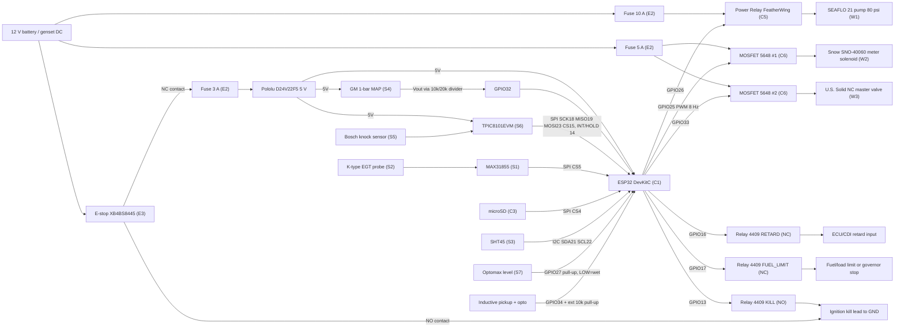

# Wiring (bench-spec rev). Pin map is authoritative in `firmware/water_inject/config.h`.

Notes
- Grounds: one star point at the battery negative. The knock sensor shield goes to TPIC ground only, so do not ground it at the engine too.
- The solenoid and valve coils need flyback diodes. The Adafruit 5648 has one on board. Add a 1N5819 across the SNO-40060 at the coil if leads are longer than 1 m.
- Relay contacts: RETARD and FUEL_LIMIT use **COM-NC**. With the coil unpowered (controller off, reset or dead) the ECU input is asserted.
  KILL uses **COM-NO** and only grounds the kill lead when commanded. The latch is held in RTC no-init RAM, so it survives watchdog, panic and software resets; only a power cycle of the controller clears it.

**Hardwired E-stop (E3).** The NO contact grounds the ignition kill lead directly. The NC contact sits between the battery and the 3 A controller fuse (F1), so it carries only controller current (well inside the contact rating). Opening it removes 5 V from the ESP32, so the pump relay (C5) opens, both MOSFETs (C6) turn off (meter solenoid shut, NC master valve closes) and the RETARD/FUEL_LIMIT relays drop to their asserted NC state. All of this follows from loss of power alone, with no firmware involvement. The 10 A pump and 5 A valve branches are not switched by the button directly, because their gate/coil drive comes from the controller. It stays pressed until twisted to release.
- The GPIO34/35/39 inputs have no internal pull-ups. GPIO34 (ignition pickup, open-collector opto) ALWAYS needs an external 10k to 3V3, or it floats and gives false RPM. GPIO39 needs an external 10k to 3V3 when the flow meter is fitted; set FLOW_METER_FITTED 1 in config.h only then (with 0 the GPIO39 interrupt is not attached).
- TPIC8101EVM: power it from 5 V, check that the SPI logic level jumper is set to 3.3 V-compatible (or add a level shifter), and check its 8 MHz clock source against `TPIC_PRESCALER`.
- Connectors: Deutsch DT (E1) at the engine-side break: (1) MAP+knock, (2) pump+valves, (3) ECU outputs, (4) EGT+pickup.
